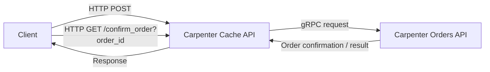

# Carpenter cache webapi
## Software Architecture

### Description

- The client communicates with the Carpenter Cache API over HTTP.
- For order creation:
  - `POST /create_order`. The data is stored in Redis DB till it is confirmed
- For confirmation:
  - `GET /confirm_order?order_id`
- The Carpenter Cache API then forwards the request to the Carpenter Orders API using gRPC.

### Flow

1. Client sends an HTTP `POST` request to `/create_order` on the Carpenter Cache API.
2. Client sends an HTTP `GET` request to `/confirm_order?order_id` on the Carpenter Cache API.
3. The Carpenter Cache API translates the request and sends a gRPC call to the Carpenter Orders API.
4. The Orders API returns the order status or confirmation.
5. The Carpenter Cache API sends the result back to the client.
